<div align="center">



[](https://github.com/CJstate)

[](https://github.com/CJstate)
[](https://github.com/CJstate)

</div>

业余在开源项目里修 bug，大多数是 Windows 才能踩到的那类：GBK 编码、符号链接、临时文件句柄、测试在 Windows 上全红。复现这些需要一台真的 Windows 机器，很多维护者没有，所以这类 issue 常常挂着没人动。

## 已合并

- [witr#242](https://github.com/pranshuparmar/witr/pull/242) — 根目录的 main.go 是符号链接，Git for Windows 默认不 clone 符号链接，拉下来变成 16 字节文本文件，go build 直接废。CI 是绿的，因为 actions/checkout 会真的建符号链接——CI 掩盖了用户真实环境。改成真实入口。
- [witr#239](https://github.com/pranshuparmar/witr/pull/239) — 不支持亮色 ANSI 的终端上，--help 的配色图例悄悄失效。按终端能力逐级回退。
- [nvm#3915](https://github.com/nvm-sh/nvm/pull/3915) — nvm --help 的 set-colors 图例输出成纯文本。
- [k8sgpt-operator#855](https://github.com/k8sgpt-ai/k8sgpt-operator/pull/855) — 给 CRD 和 chart 加 tolerations，控制器能调度到被打 taint 的节点。
- [dependency-track#7096](https://github.com/DependencyTrack/dependency-track/pull/7096) — README 的 CI 徽章指向已废弃的分支，点了 404。

## 在评

目前 25 个 open PR，分布在 accelerate、datasets、mlflow、pytorch-lightning、llm、pinact、ggc、posting 这些项目里，其中 7 个 CI 全绿在等 review。完整清单在 [CONTRIBUTIONS.md](CONTRIBUTIONS.md)。

两个花的时间比较多的：

<details>
<summary>llm#1737：写模板用 UTF-8，读回来却吃系统编码</summary>

cp936 的 Windows 上 llm -t 模板直接抛 UnicodeDecodeError。查下来是 templates edit 新建模板时用 write_text(..., "utf-8") 写，几行之后 load_template() 用 read_text() 读，没指定编码。修法是加一个 _read_text_file()：先按 UTF-8 读，不是合法 UTF-8 才回退 locale，老的 GBK 模板不受影响。带三个回归测试，先红后绿。

[PR](https://github.com/simonw/llm/pull/1737)

</details>

<details>
<summary>accelerate#4360：debug_launcher 在 Windows 起不来，三处 Unix 假设</summary>

一处把 start_method 写死成 fork；一处 rendezvous 文件用 NamedTemporaryFile 建，句柄还攥在父进程手里，spawn 出来的子进程打不开；还有一处把回环口写死成 lo。三个点各修各的，修完本机多进程调试能正常跑。

[PR](https://github.com/huggingface/accelerate/pull/4360)

</details>

## 自己写的两个东西

<table>
<tr>
<td width="50%" valign="top">

#### [llm-eval-gate](https://github.com/CJstate/llm-eval-gate)

判断一次 LLM 评测的分数变化是真退化还是噪声：吃两份 lm-evaluation-harness 的结果，按标准误算噪声带，超出才让 CI 挂。零运行时依赖。


```bash
pip install "git+https://github.com/CJstate/llm-eval-gate@v0.1.0"
llm-eval-gate check before.json after.json
```

</td>
<td width="50%" valign="top">

#### [hui-harness](https://github.com/CJstate/hui-harness)

3k 行、零依赖的编程 Agent。会话日志是哈希链，hui replay 会重放并逐条核对 sha256。写它主要是想把 agent harness 的每个部件都亲手过一遍。


```bash
pip install -e . && hui demo
hui replay .sessions/session-*.jsonl
```

</td>
</tr>
</table>

## 常用的


<div align="center">
<picture>
  <source media="(prefers-color-scheme: dark)" srcset="https://raw.githubusercontent.com/CJstate/CJstate/output/github-contribution-grid-snake-dark.svg"/>
  <source media="(prefers-color-scheme: light)" srcset="https://raw.githubusercontent.com/CJstate/CJstate/output/github-contribution-grid-snake.svg"/>
  
</picture>
</div>

---

联系我：1507965754@qq.com
