这张数据板不是第三方卡片服务生成的——仓库里的 <a href="tools/render_profile.py">render_profile.py</a> 每天由 GitHub Action 从 GitHub API 拉取真实数据渲染而成。数字会自己更新，也能随时复查。

写 Python 和 Go，喜欢把工具做到**零依赖**，把测试做到**任何一台机器上都能复现**。

上游修 bug 的口味偏刁：专挑 CI 结构上抓不到的问题——符号链接、locale 编码、测试污染、被 mock 劫持的命令。**绿灯和用户报错之间那道缝，就是我在找的东西。**

这个页面本身也是一条流水线：本仓库没有第三方徽章和统计卡，所有图形都是仓库内代码从 API 实时生成的 SVG。修 bug 是主业，让展示 bug 的页面也经得起看是顺手的事。

## 🏛️ 参与过的项目

## 💼 两个能说明「CI 为什么抓不到它们」的 case

<b>witr#242（已合并）</b> — CI 掩盖了用户的真实环境

根目录的 `main.go` 是受版本控制的符号链接。Git for Windows 默认不检出符号链接，用户 clone 下来是一个 16 字节的文本文件，`go build` 全废——而 CI 一直是绿的，因为 `actions/checkout` 会真的建出符号链接。改成真实入口 + lint 守卫，让 CI 不再依赖 checkout 的副作用。[PR](https://github.com/pranshuparmar/witr/pull/242)

<b>simonw/llm#1737</b> — 写用 UTF-8，读却吃系统编码

cp936 的 Windows 上 `llm -t 模板` 直接抛 `UnicodeDecodeError`：`templates edit` 用 `write_text(..., "utf-8")` 写，几行之后 `load_template()` 用没指定编码的 `read_text()` 读。修法是先按 UTF-8 读、确认不是合法 UTF-8 才回退 locale，老的 GBK 模板不受影响，三个回归测试先红后绿。这个页面的生成器在写完后第一天就在 cp936 上踩了同一个坑——同一个 bug 类，隔天就出现在自己身上，测试先行这一课算是刻进去了。[PR](https://github.com/simonw/llm/pull/1737)

<b>huggingface/accelerate#4360</b> — debug_launcher 的三处 Unix 假设

`start_method` 写死 `"fork"`；rendezvous 文件用 `NamedTemporaryFile` 建、句柄攥在父进程手里，spawn 的子进程打不开；回环网卡名写死 `lo`。三处各自独立，分别修，修完本机多进程调试恢复正常。[PR](https://github.com/huggingface/accelerate/pull/4360)

<b>其余已合并</b> 与完整在评清单

- [witr#239](https://github.com/pranshuparmar/witr/pull/239) — 不支持高亮 ANSI 的终端上 `--help` 配色图例静默降级，按终端能力逐级回退（已合并）
- [nvm#3915](https://github.com/nvm-sh/nvm/pull/3915) — `nvm --help` 的 set-colors 图例输出为未着色文本（已合并）
- [k8sgpt-operator#855](https://github.com/k8sgpt-ai/k8sgpt-operator/pull/855) — 为 CRD 与 chart 增加 tolerations（已合并）
- [dependency-track#7096](https://github.com/DependencyTrack/dependency-track/pull/7096) — README 的 CI 徽章指向已废弃分支（已合并）
- 在评 PR 的完整清单与逐条状态：[CONTRIBUTIONS.md](CONTRIBUTIONS.md)

## 🛠️ 用什么

`Python 3.9–3.13` · `Go` · `PyTorch / Transformers / Accelerate` · `pytest` · `GitHub Actions` · `Docker / Kubernetes` · 一台 cp936 的 Windows，和承受它的耐心。

---

<picture>
  <source media="(prefers-color-scheme: dark)" srcset="docs/metrics-dark.svg" width="100%"/>
  <source media="(prefers-color-scheme: light)" srcset="docs/metrics-light.svg" width="100%"/>
  
</picture>
