  

  
  
  

👇 **Check out my featured contributions in the pinned repositories below.**

---

### Hi, I'm CJstate 👋

Backend engineer working on **Go infrastructure, cloud-native tooling, and reliable data paths**. I reproduce a defect locally, write the failing test first, and open a PR only after the affected suites, vet, and formatting are green. Most fixes start with a failure I actually hit: a writer that accepts only part of a buffer, a reader that mistakes a write error for a clean end of stream, an inherited environment scope that quietly widens.

#### 💻 Stack

  

   

#### 🚀 Featured Open Source Contributions

> Merged pull requests only. Still-open and withdrawn PRs are deliberately omitted - I would rather show the fixes that actually shipped.

- 🛠️ **[klauspost/compress - #1302](https://github.com/klauspost/compress/pull/1302)**: `gzip.Reader.WriteTo` stored a destination write error in `z.err`, which doubles as the end-of-stream marker. A failed write was therefore mistaken for a clean end of stream and the CRC/trailer check was silently skipped. Writer errors are now wrapped with `%w` so they stay distinct from `io.EOF`. Merged by the author.

- ⚡ **[k8sgpt-ai/k8sgpt - #1845](https://github.com/k8sgpt-ai/k8sgpt/pull/1845)**: Findings already known to an operator had no way to be silenced, so every analysis re-reported them. Added an `exclusions` config key with a content hash and expiry, applied before analysis and in server mode, with the muted count reported so a mute cannot silently swallow findings.

- 🐳 **[dagucloud/dagu](https://github.com/dagucloud/dagu/pulls?q=is%3Apr+author%3ACJstate+is%3Amerged)**: A run of merged fixes across the workflow engine - unknown-key validation for the `jq`, `http`, `archive`, `s3`, `redis`, `postgres`, `sqlite`, and `mail` executors ([#3558](https://github.com/dagucloud/dagu/pull/3558), [#3559](https://github.com/dagucloud/dagu/pull/3559), [#3570](https://github.com/dagucloud/dagu/pull/3570)-[#3574](https://github.com/dagucloud/dagu/pull/3574)), `repeat_policy.on_limit: fail` for exhausted `until` loops ([#3651](https://github.com/dagucloud/dagu/pull/3651)), and inheriting a `foreach` parent's env scope in body steps ([#3657](https://github.com/dagucloud/dagu/pull/3657)).

- 🗄️ **[cybozu-go/moco - #966](https://github.com/cybozu-go/moco/pull/966)**: The Helm chart gave controller pods no way to carry custom metadata. Added support for custom labels and annotations on controller pods.

- 📦 **[klauspost/compress - #1303](https://github.com/klauspost/compress/pull/1303)**: Kept `ErrCorrupt` instead of losing the failure when `s2.Skip` rejects an oversized chunk, so a corrupt stream cannot be reported as a clean skip. Its sibling [flate fix - #1304](https://github.com/klauspost/compress/pull/1304) keeps the reader failed after a short write inside `WriteTo`, and [#1316](https://github.com/klauspost/compress/pull/1316) reports short writes when closing the CRC/ISIZE footer.

- ⚡ **[valyala/fasthttp](https://github.com/valyala/fasthttp/pulls?q=is%3Apr+author%3ACJstate+is%3Amerged)**: Five exported `WriteTo` implementations returned the raw result of a single `w.Write`, silently swallowing short writes. They now surface `io.ErrShortWrite` ([#2541](https://github.com/valyala/fasthttp/pull/2541) and follow-ups [#2542](https://github.com/valyala/fasthttp/pull/2542), [#2543](https://github.com/valyala/fasthttp/pull/2543)). Also fixed `Accept-Encoding` parsing that stopped scanning after a `q=0` member ([#2590](https://github.com/valyala/fasthttp/pull/2590)).

- 📈 **[prometheus/prometheus - #20352](https://github.com/prometheus/prometheus/pull/20352)**: Gauge histograms lost their metadata type in remote write because the lookup mixed the `dto` enum spelling (`GAUGE_HISTOGRAM`) with the `prompb` map key (`GAUGEHISTOGRAM`). Fixed the mapping so the type survives the conversion.

- 🔧 **[juanfont/headscale - #3650](https://github.com/juanfont/headscale/pull/3650)**: Pre-0.23 databases without a migrations table were migrated blindly and could be corrupted; they are now rejected with a clear error. In [bmf-san/ggc - #542](https://github.com/bmf-san/ggc/pull/542) and [pranshuparmar/witr - #242](https://github.com/pranshuparmar/witr/pull/242), Unix-only process mocks and a tracked symlink made `go build`/`go test` fail on a real Windows checkout while CI stayed green.

- 🧠 **[Lynpoint/CyberVerse](https://github.com/Lynpoint/CyberVerse/pulls?q=is%3Apr+author%3ACJstate+is%3Amerged)**: A run of RAG fixes — explicit zero-valued config fields no longer fall back to defaults, Milvus delete expressions escape backslashes and quotes, plugin shutdown continues after a startup failure, and YAML `${VAR}` expansion treats env values as data rather than re-parsing them as YAML.

---

#### 📊 Activity

> Every number below is fetched from the GitHub API and regenerated by CI every 6 hours — nothing is typed in by hand.

  

  

---

#### 🐍 Contribution Graph

  <picture>
    <source media="(prefers-color-scheme: dark)" srcset="./docs/snake-dark.svg">
    <source media="(prefers-color-scheme: light)" srcset="./docs/snake-light.svg">
    
  </picture>

---

#### 🧪 Projects

- **[Veritas-Harness](https://github.com/CJstate/Veritas-Harness)**: An audit-friendly runtime for coding agents. Every tool call, model reply and MCP request lands in a hash-chained JSONL log; `veritas replay` verifies the chain, re-runs the tools and diffs each result by SHA-256 — a run is verified, not trusted. 141 tests, zero runtime dependencies, CI green on Linux / Windows / macOS × Python 3.10–3.13.

- **[EvalGuard](https://github.com/CJstate/EvalGuard)**: A CI gate for LLM evaluation output. Given `before` / `after` result files, it decides whether a benchmark genuinely regressed using a relative threshold plus a standard-error band, instead of turning the build red over a third-decimal wobble. 107 tests, zero runtime dependencies, offline demo included.

---

 

### 🤝 Connect with me

Bug reports, reproducible failures, and patches for upstream Go projects are always welcome.
The fastest way to reach me is email; the profile above stays the source of truth for my work.

  
  

 

*"Reproduce it. Write the failing test. Ship the smallest fix that makes it green."*

