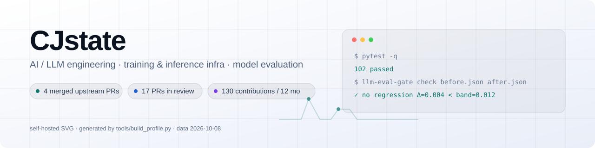

<p align="center">
  <picture>
    <source media="(prefers-color-scheme: dark)" srcset="docs/banner-dark.svg">
    <source media="(prefers-color-scheme: light)" srcset="docs/banner-light.svg">
    
  </picture>
</p>

<p align="center">
  <a href="https://github.com/CJstate/llm-eval-gate"></a>
  <a href="https://github.com/CJstate/llm-eval-gate/actions"></a>
  <a href="https://github.com/CJstate/hui-harness"></a>
  <a href="#-已合并-5"></a>
  <a href="#-在评-25"></a>
  
  
</p>

---

> [!NOTE]
> **30 秒版本** —— 我的上游 PR 进过 **witr（22.6k★）、nvm（95k★）、k8sgpt-operator、dependency-track** 的主干，每一条都能点开 commit 看 diff。我专修**只在真实环境出现的 bug**：CI 全绿但 Windows 检出编译失败、中文 Windows 上 UTF-8 读不回来、`v4` 与 `v4.0.0` 是同一版本却被判「不更新」。这类问题复现成本高，所以每个修复都带完整根因链 + 回归测试。两个个人项目遵循同一原则：**零依赖、证据可复现**。

<h2 align="center">🔗 速览</h2>

<table>
<tr>
<td width="50%" valign="top">

### ✅ 已合并（5）

进过 **4 个上游仓库**的主干，合计覆盖 **122,587★** 的项目：

| PR | 内容 |
| --- | --- |
| [witr#242](https://github.com/pranshuparmar/witr/pull/242) | 符号链接入口 → 真实 `main.go` |
| [witr#239](https://github.com/pranshuparmar/witr/pull/239) | 终端颜色按能力回退 |
| [nvm#3915](https://github.com/nvm-sh/nvm/pull/3915) | help 图例着色 |
| [k8sgpt-operator#855](https://github.com/k8sgpt-ai/k8sgpt-operator/pull/855) | tolerations 支持 |
| [dependency-track#7096](https://github.com/DependencyTrack/dependency-track/pull/7096) | CI 徽章修复 |

<sub>详细说明见下方「已合并」章节。</sub>

</td>
<td width="50%" valign="top">

### 🚧 在评（25）

按领域分布：

- **训练与推理** 6 —— accelerate ×2 · pytorch-lightning ×3 · datasets
- **评测与观测** 4 —— mlflow · lm-eval ×2 · openllmetry
- **工具链 / DX** 15 —— pinact ×3 · posting ×2 · ggc ×3 · witr · hallmark ×2 · llm · jev · skills · public-apis

全部点得开、逐条带「一句话内容 + 当前状态」。

<sub>完整清单见下方「在评」章节。</sub>

</td>
</tr>
</table>

---

## 🔵 已合并（5）

<details open>
<summary><b>每个 PR 做了什么</b>（全部已进上游主干）</summary>

| 项目 | PR | 一句话 | 合并 |
| --- | --- | --- | --- |
| [witr](https://github.com/pranshuparmar/witr) `22.6k★` | [#242](https://github.com/pranshuparmar/witr/pull/242) | 根 `main.go` 是符号链接，Windows 检出后 `go build` 全废 → 改为真实入口 + lint 守卫 | 2026-10-04 |
| [witr](https://github.com/pranshuparmar/witr) `22.6k★` | [#239](https://github.com/pranshuparmar/witr/pull/239) | 不支持高亮 ANSI 的终端上配色被静默降级 → 按终端能力逐级回退 | 2026-10-03 |
| [nvm](https://github.com/nvm-sh/nvm) `95.3k★` | [#3915](https://github.com/nvm-sh/nvm/pull/3915) | `nvm --help` 颜色图例未着色 → help 分支应用同一套颜色变量 | 2026-09-03 |
| [k8sgpt-operator](https://github.com/k8sgpt-ai/k8sgpt-operator) | [#855](https://github.com/k8sgpt-ai/k8sgpt-operator/pull/855) | CRD/chart 增加 `tolerations`，控制器可调度到被 taint 的节点 | 2026-10-10 |
| [dependency-track](https://github.com/DependencyTrack/dependency-track) | [#7096](https://github.com/DependencyTrack/dependency-track/pull/7096) | README CI 徽章 404 → 改指 `main` | 2026-08-24 |

</details>

## 🔬 深挖案例：我是怎么修一个 bug 的

<details>
<summary><b>案例 1 · simonw/llm#1737</b> —— 同一个模块写文件用 UTF-8，读文件却用系统 locale</summary>

| | |
| --- | --- |
| **现象** | cp936 的 Windows 上 `llm -t 模板` 直接失败：`UnicodeDecodeError: 'gbk' codec can't decode byte 0xaa`。`-f` 片段与 `--functions` 同样打不开。 |
| **根因** | 写入是 `path.write_text(..., "utf-8")`（`llm/cli.py:2646`），读回是 `path.read_text()`（`llm/cli.py:4274`）——locale 默认编码。三处入口同病。 |
| **修复** | 抽出 `_read_text_file()`：UTF-8 优先、确实不是合法 UTF-8 才回退 locale，旧 GBK/CP1252 文件不受影响。与仓库里 `embed-multi --files` 的既有回退策略一致。 |
| **证据** | 3 个回归测试先失败后通过；全量 `1185 passed, 1 skipped, 6 xfailed, 15 xpassed`。 |

🔗 [打开 PR](https://github.com/simonw/llm/pull/1737)
</details>

<details>
<summary><b>案例 2 · witr#242（已合并）</b> —— CI 全绿，真实 Windows 检出连编译都过不去</summary>

| | |
| --- | --- |
| **现象** | clone 后 `go build ./...` 报 `expected 'package', found cmd`；而仓库 CI 的 Windows job 是绿的。 |
| **根因** | `git ls-files -s main.go` 显示 mode `120000`：根入口是符号链接。Git for Windows 默认 `core.symlinks=false`，落盘成 16 字节文本文件。CI 掩盖了它，因为 `actions/checkout` 会真的创建符号链接。 |
| **修复** | 根入口改为真实文件，入口逻辑抽到 `internal/app.Main()`；lint 加守卫：受版本控制的文件不允许是 `120000`。 |
| **证据** | 七组交叉编译 exit 0；两个构建产物的 `--help`/`--version` 输出逐字节一致 —— 重构零行为变化。 |

🔗 [打开 PR](https://github.com/pranshuparmar/witr/pull/242)
</details>

<details>
<summary><b>案例 3 · accelerate#4360</b> —— `debug_launcher` 里三处 Unix-only 假设</summary>

| | |
| --- | --- |
| **现象** | Windows 上先 `ValueError: cannot find context for 'fork'`，绕过后 `PermissionError: [Errno 13]`。 |
| **根因** | 硬编码 `start_method="fork"`；rendezvous 用 `NamedTemporaryFile`（父进程持句柄，spawn 子进程打不开）；无条件设 `gloo_socket_ifname="lo"`。 |
| **修复** | 按平台能力选 `fork`/`spawn`；`TemporaryDirectory` 只传路径不持句柄；先探测 `lo` 存在才设置。 |
| **证据** | 本机复现 → 修复后多进程调试正常启动；测试在 Python 3.13 + torch 2.9 通过。 |

🔗 [打开 PR](https://github.com/huggingface/accelerate/pull/4360)
</details>

## 🟢 在评（25）

<details>
<summary><b>训练与推理框架（6）</b></summary>

| PR | 内容 | 状态 |
| --- | --- | --- |
| [accelerate#4361](https://github.com/huggingface/accelerate/pull/4361) | checkpoint 随机状态恢复失败时按 rank 一次性告警，而不是静默继续 | 等批准 workflow |
| [accelerate#4360](https://github.com/huggingface/accelerate/pull/4360) | `debug_launcher` 三处 Unix-only 假设（见案例 3） | 等批准 workflow |
| [pytorch-lightning#21975](https://github.com/Lightning-AI/pytorch-lightning/pull/21975) | `enable_device_summary` 与既有参数组合行为不一致，补开关与文档 | 等批准 workflow |
| [datasets#8693](https://github.com/huggingface/datasets/pull/8693) | 注解接受 `List[...]` 却拒绝 `Sequence[...]`，补齐类型判定 | 等批准 workflow |
| [pytorch-lightning#21974](https://github.com/Lightning-AI/pytorch-lightning/pull/21974) | 文档 `:emphasize-lines:` 行号按渲染后行计算 | 等批准 workflow |
| [pytorch-lightning#21939](https://github.com/Lightning-AI/pytorch-lightning/pull/21939) | 无符号链接权限时跳过并说明，而不是判失败 | 等批准 workflow |

</details>

<details>
<summary><b>评测与可观测性（4）</b></summary>

| PR | 内容 | 状态 |
| --- | --- | --- |
| [mlflow#26206](https://github.com/mlflow/mlflow/pull/26206) | artifact 图片按容器宽度自适应，不再强制缩放 | 等核心维护者批准 |
| [lm-eval-harness#4216](https://github.com/EleutherAI/lm-evaluation-harness/pull/4216) | `make_table` 对共享子任务重复计数 | 等批准 workflow + CLA |
| [openllmetry#4484](https://github.com/traceloop/openllmetry/pull/4484) | Groq 流式 usage 丢失，补 token 统计 + 回归测试 | 已 rebase，等 review |
| [lm-eval-harness#4114](https://github.com/EleutherAI/lm-evaluation-harness/pull/4114) | `simple_evaluate` 非法输入静默返回空，补输入校验 | 等批准 workflow + CLA |

</details>

<details open>
<summary><b>工具链 / 平台 DX（15）</b></summary>

| PR | 内容 | 状态 |
| --- | --- | --- |
| [pinact#1779](https://github.com/suzuki-shunsuke/pinact/pull/1779) | `uses` 行操作全静默 → 每行 INFO/WARN 日志（含 `--no-api`） | 签名 ✅ 等 review |
| [pinact#1780](https://github.com/suzuki-shunsuke/pinact/pull/1780) | 只打 tag 不发 release 时版本解析短路 → tags 始终参与 | 签名 ✅ 等 review |
| [pinact#1781](https://github.com/suzuki-shunsuke/pinact/pull/1781) | `v4`==`v4.0.0` 被判不更新、`-u` 与 pin 结果不一致 → 语义相等 + 注解展开 | 签名 ✅ 等 review |
| [posting#400](https://github.com/darrenburns/posting/pull/400) | 高亮即打开（可配置、默认关）+ 修挂载期 compose 竞态 | 等 review |
| [posting#401](https://github.com/darrenburns/posting/pull/401) | Response 区常驻「METHOD URL」归属提示 | 等 review |
| [ggc#540](https://github.com/bmf-san/ggc/pull/540) | Windows 下 config/interactive/history 测试全红 → 夹具 + GOOS 门禁 | 首贡献门禁待批 |
| [ggc#541](https://github.com/bmf-san/ggc/pull/541) | 101 处 `exec.Command("echo")` mock 被真 echo.exe 劫持 → helper process | 首贡献门禁待批 |
| [ggc#542](https://github.com/bmf-san/ggc/pull/542) | 编辑器桩与临时目录清理 → 共享 `testutil` | 首贡献门禁待批 |
| [witr#245](https://github.com/pranshuparmar/witr/pull/245) | `TestDetectGitInfo` 被上层真实 git 仓库污染 → hermetic fixture | 等 review |
| [hallmark#77](https://github.com/Nutlope/hallmark/pull/77) | 13 处 `../../` 相对链接装完即死 → 绝对 URL + 链接检查器 | 等 review |
| [llm#1737](https://github.com/simonw/llm/pull/1737) | 写 UTF-8 读 locale（见案例 1） | 等批准 workflow |
| [jev-ultrafast#114](https://github.com/browser-use/jev-ultrafast/pull/114) | no-progress guard 误判「无观测」为「无进展」 | 等 review |
| [skills#1720](https://github.com/anthropics/skills/pull/1720) | `mcp-builder` 评估报告 locale 编码乱码 → 显式 UTF-8 | 等 review |
| [public-apis#7217](https://github.com/public-apis/public-apis/pull/7217) | Pirate Weather 条目失效 → 官方入口 | 等 review |
| [hallmark#72](https://github.com/Nutlope/hallmark/pull/72) | macrostructure 文档补全 | 等 review |

</details>

## 🧰 自己的项目

<table>
<tr>
<td width="50%" valign="top">

### [llm-eval-gate](https://github.com/CJstate/llm-eval-gate)

**把「评测退化」变成 CI 的退出码。** 吃两份 lm-evaluation-harness 结果文件，在考虑随机波动的前提下判定这次评测是不是真的退化了 —— 相对阈值 + 基于标准误的噪声带，而不是「小数点后几位变小就红」。

<a href="https://github.com/CJstate/llm-eval-gate/actions/workflows/ci.yml"></a>


```bash
pip install "git+https://github.com/CJstate/llm-eval-gate@v0.1.0"
llm-eval-gate check before.json after.json
```

</td>
<td width="50%" valign="top">

### [hui-harness](https://github.com/CJstate/hui-harness)

**零依赖、可重放的编程 Agent。** 工具调用循环 + 权限策略 + 会话日志，约 3k 行纯标准库。会话是哈希链：`hui replay` 真的重跑一遍并逐条核对 sha256，对不上当场失败 —— 「可复现」是被 CI 验证的，不是被声称的。


```bash
pip install -e . && hui demo
hui replay .sessions/session-*.jsonl
```

</td>
</tr>
</table>

## 🧭 工作方式

**先复现，再动手** —— 每个修复从一条能贴出来的报错开始，修完贴修复后的输出（上面案例的「现象」栏都是原始报错）。**最小 diff + 回归测试** —— 不夹带格式化和顺手重构。**挑环境类缺陷而非抢热点** —— 非 UTF-8 默认编码、Windows 检出、首贡献者 CI 门禁、跨平台终端差异：复现成本高、报告少，但每个都是真人会踩的坑。**公开更正自己** —— 早期被维护者指出过噪声提交和误判，复盘都留在 PR 里，构成我现在的提交标准。

## 📊 GitHub 统计

<p align="center">
  <picture>
    <source media="(prefers-color-scheme: dark)" srcset="https://github-readme-stats.vercel.app/api?username=CJstate&show_icons=true&hide_border=true&bg_color=0a0f1e&title_color=4dd4c0&text_color=c9d1d9&icon_color=4dd4c0&hide=issues,contribs" />
    <source media="(prefers-color-scheme: light)" srcset="https://github-readme-stats.vercel.app/api?username=CJstate&show_icons=true&hide_border=true&bg_color=e9eef8&title_color=0f766e&text_color=0b1220&icon_color=0f766e&hide=issues,contribs" />
    
  </picture>
  <picture>
    <source media="(prefers-color-scheme: dark)" srcset="https://github-readme-streak-stats.herokuapp.com/?user=CJstate&hide_border=true&background=0a0f1e&ring=4dd4c0&fire=f0883e&currStreakLabel=4dd4c0" />
    <source media="(prefers-color-scheme: light)" srcset="https://github-readme-streak-stats.herokuapp.com/?user=CJstate&hide_border=true&background=e9eef8&ring=0f766e&fire=f0883e&currStreakLabel=0f766e" />
    
  </picture>
</p>

## 🧱 技术栈

| 方向 | 常用 |
| --- | --- |
| **语言** | Python（3.9–3.13）· Go · TypeScript · Shell · PowerShell |
| **训练 / 推理** | PyTorch · 🤗 Transformers · 🤗 Accelerate · 🤗 PEFT · FSDP · DeepSpeed · vLLM |
| **数据 / 评测** | 🤗 Datasets · lm-evaluation-harness · MLflow · OpenLLMetry / OpenTelemetry |
| **工程** | pytest · ruff · mypy · GitHub Actions（Windows / macOS matrix）· Docker · k8s |
| **平台** | Windows 与 Linux 双栈 · 终端能力探测 · 编码 / locale 兼容 · 交叉编译 |

---

<p align="center">
  <sub>每个数字都能点开验证 · 每个修复都带复现证据</sub><br/>
  <a href="https://github.com/CJstate"></a>
</p>
