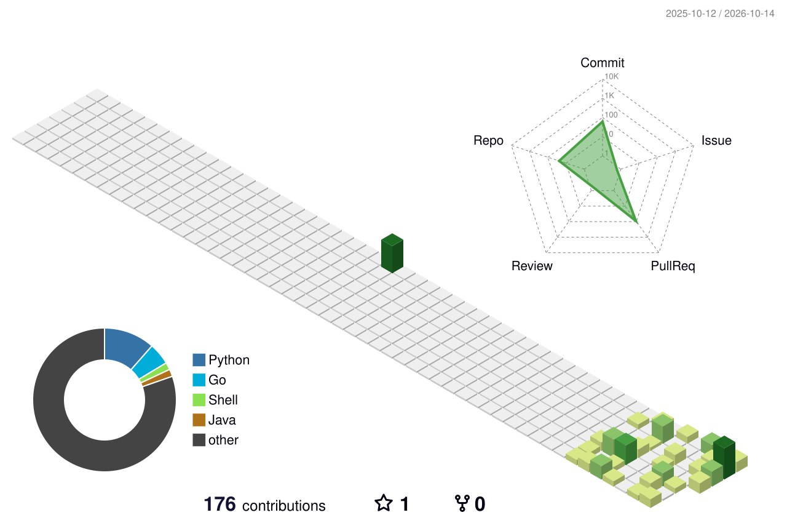

<picture>
  <source media="(prefers-color-scheme: dark)" srcset="docs/coding.gif" />
  <source media="(prefers-color-scheme: light)" srcset="docs/jobs.png" height="225px" />
  
</picture>

&nbsp;

  

<picture>
  <source media="(prefers-color-scheme: dark)" srcset="https://raw.githubusercontent.com/CJstate/CJstate/output/github-contribution-grid-snake-dark.svg" />
  <source media="(prefers-color-scheme: light)" srcset="https://raw.githubusercontent.com/CJstate/CJstate/output/github-contribution-grid-snake.svg" />
  
</picture>

# 🙋 Hello

<table>
<tr><td>

### 🤺 About Me

&emsp;&emsp;嗨，我是 Jinhui Chen。写 Python 和 Go，喜欢把工具做到<strong>零依赖</strong>，把测试做到<strong>任何一台机器上都能复现</strong>。

&emsp;&emsp;自己写了两个小而硬的东西：一个纯标准库的编程 agent harness，一个给 LLM 评测判「真退化还是噪声」的统计门禁。

&emsp;&emsp;上游那边修 bug 的口味偏刁：专挑 CI 结构上抓不到的问题——符号链接、locale 编码、测试污染、被 mock 劫持的命令。<strong>绿灯和用户报错之间那道缝，就是我在找的东西。</strong>

&emsp;&emsp;<strong>Small tools, zero dependencies, and the bugs CI cannot see.</strong>

</td></tr>
</table>

# 💼 上游贡献

<table>
<tr><td>

### 🏛️ 参与过的项目

</td></tr>
</table>

<table>
<tr><td>

<strong>已合并 5 个</strong>，在评 25 个（完整清单见 <a href="CONTRIBUTIONS.md">CONTRIBUTIONS.md</a>）。挑两个能说明「CI 为什么抓不到它们」的：

<b>witr#242</b> — CI 掩盖了用户的真实环境

根目录的 `main.go` 是受版本控制的符号链接。Git for Windows 默认不检出符号链接，用户 clone 下来是一个 16 字节的文本文件，`go build` 全废——而 CI 一直是绿的，因为 `actions/checkout` 会真的建出符号链接。改成真实入口 + lint 守卫，让 CI 不再依赖 checkout 的副作用。[PR](https://github.com/pranshuparmar/witr/pull/242)（已合并）

<b>simonw/llm#1737</b> — 写用 UTF-8，读却吃系统编码

cp936 的 Windows 上 `llm -t 模板` 直接抛 `UnicodeDecodeError`：`templates edit` 用 `write_text(..., "utf-8")` 写，几行之后 `load_template()` 用没指定编码的 `read_text()` 读。修法是先按 UTF-8 读、确认不是合法 UTF-8 才回退 locale，老的 GBK 模板不受影响，三个回归测试先红后绿。[PR](https://github.com/simonw/llm/pull/1737)

<b>huggingface/accelerate#4360</b> — debug_launcher 的三处 Unix 假设

`start_method` 写死 `"fork"`；rendezvous 文件用 `NamedTemporaryFile` 建、句柄攥在父进程手里，spawn 的子进程打不开；回环网卡名写死 `lo`。三处各自独立，分别修，修完本机多进程调试恢复正常。[PR](https://github.com/huggingface/accelerate/pull/4360)

<b>其余已合并</b>

- [witr#239](https://github.com/pranshuparmar/witr/pull/239) — 不支持高亮 ANSI 的终端上 `--help` 配色图例静默降级，按终端能力逐级回退
- [nvm#3915](https://github.com/nvm-sh/nvm/pull/3915) — `nvm --help` 的 set-colors 图例输出为未着色文本
- [k8sgpt-operator#855](https://github.com/k8sgpt-ai/k8sgpt-operator/pull/855) — 为 CRD 与 chart 增加 tolerations，控制器可调度到被 taint 的节点
- [dependency-track#7096](https://github.com/DependencyTrack/dependency-track/pull/7096) — README 的 CI 徽章指向已废弃分支，点开 404

</td></tr>
</table>

# 📊 Activity Overview

<picture>
  <source media="(prefers-color-scheme: dark)" srcset="https://github-readme-stats.vercel.app/api?username=CJstate&show_icons=true&hide_border=true&bg_color=00000000&title_color=6ea8fe&icon_color=3fb6a8&text_color=aebdda&include_all_commits=true" />
  <source media="(prefers-color-scheme: light)" srcset="https://github-readme-stats.vercel.app/api?username=CJstate&show_icons=true&hide_border=true&bg_color=00000000&title_color=0969da&icon_color=1f883d&text_color=1f2328&include_all_commits=true" />
  
</picture>

<picture>
  <source media="(prefers-color-scheme: dark)" srcset="https://github-readme-streak-stats.herokuapp.com?user=CJstate&hide_border=true&background=00000000&stroke=24306a&ring=6ea8fe&fire=3fb6a8&currStreakLabel=6ea8fe" />
  <source media="(prefers-color-scheme: light)" srcset="https://github-readme-streak-stats.herokuapp.com?user=CJstate&hide_border=true&background=00000000&stroke=d0d7de&ring=0969da&fire=1f883d&currStreakLabel=0969da" />
  
</picture>

<picture>
  <source media="(prefers-color-scheme: dark)" srcset="profile-3d-contrib/profile-season-animate.svg" />
  <source media="(prefers-color-scheme: light)" srcset="profile-3d-contrib/profile-green-animate.svg" />
  
</picture>

# 🛠️ Tech Stack

---
