# CJstate

  

  

Backend engineer focused on Go infrastructure and LLM tooling. I work mainly on Prometheus (CNCF), Kubernetes tooling, and Python ML infrastructure — and I run Windows as a daily driver, which is how I keep running into the bugs that never show up on Linux CI.

**Stack:** Go · Python · Kubernetes · Docker · Prometheus · GitHub Actions

## Open source

Merged pull requests only, with the defect each one removed. Withdrawn and
still-open PRs are deliberately omitted: I would rather show the fixes that
actually shipped than the ones still in review.

| Project | PR | What it fixed |
| --- | --- | --- |
| [nvm-sh/nvm](https://github.com/nvm-sh/nvm) | [#3915](https://github.com/nvm-sh/nvm/pull/3915) | `nvm --help` printed the set-colors legend as literal escape sequences instead of rendering it in color. |
| [klauspost/compress](https://github.com/klauspost/compress) | [#1302](https://github.com/klauspost/compress/pull/1302) | `gzip.Reader.WriteTo` stored a destination write error in `z.err`, which doubles as the end-of-stream marker, so a failed write was mistaken for a clean end of stream and the CRC/trailer check was silently skipped. Writer errors are now wrapped so they stay distinct from `io.EOF`. Two sibling fixes in the same package followed: [#1303](https://github.com/klauspost/compress/pull/1303) (s2 keeps `ErrCorrupt`) and [#1304](https://github.com/klauspost/compress/pull/1304) (flate keeps the reader failed after a short write). |
| [k8sgpt-ai/k8sgpt](https://github.com/k8sgpt-ai/k8sgpt) | [#1845](https://github.com/k8sgpt-ai/k8sgpt/pull/1845) | Findings already known to an operator had no way to be silenced, so every analysis re-reported them. Added an `exclusions` config key with a content hash and expiry, applied before the AI call and in server mode, with the muted count reported so a mute cannot silently swallow findings. |
| [juanfont/headscale](https://github.com/juanfont/headscale) | [#3650](https://github.com/juanfont/headscale/pull/3650) | Pre-0.23 databases without a migrations table were migrated blindly; now they are rejected with a clear error instead of being corrupted. |
| [pranshuparmar/witr](https://github.com/pranshuparmar/witr) | [#242](https://github.com/pranshuparmar/witr/pull/242) | The root `main.go` was a tracked symlink. Git for Windows checks symlinks out as plain text, so `go build` failed on a real clone while CI stayed green. Replaced it with a real entry point and added a lint guard for tracked symlinks. |
| [dagucloud/dagu](https://github.com/dagucloud/dagu) | [#3554](https://github.com/dagucloud/dagu/pull/3554) | `mark_success` was ignored for non-retryable exit codes, so marked steps still failed the workflow. |
| [dagucloud/dagu](https://github.com/dagucloud/dagu) | [#3578](https://github.com/dagucloud/dagu/pull/3578) | Regenerated `llms.txt` and added a CI check that keeps it in sync with the skills tree. |
| [k8sgpt-ai/k8sgpt-operator](https://github.com/k8sgpt-ai/k8sgpt-operator) | [#855](https://github.com/k8sgpt-ai/k8sgpt-operator/pull/855) | Added tolerations to the K8sGPT CRD and Helm chart so the controller can schedule on tainted nodes. |
| [bmf-san/ggc](https://github.com/bmf-san/ggc) | [#542](https://github.com/bmf-san/ggc/pull/542) | The config and command test suites relied on Unix-only exec mocks; they now pass on Windows. |

Most of my fixes start from a failure I hit locally: a Windows checkout that will not compile, a GBK locale that mangles a template file, a timestamp that drifts by a few nanoseconds. I reproduce it, write the failing test first, and open the PR only after the affected suites, vet and formatting are all green.

## Activity

  

  

## Projects

### [Veritas-Harness](https://github.com/CJstate/Veritas-Harness)

A coding-agent runtime you can audit. Every tool call, model reply and MCP request lands in a hash-chained JSONL log; `veritas replay` verifies the chain, re-runs the tools, and diffs each fresh result by SHA-256 — a run is verified, not trusted.

- 141 tests, zero runtime dependencies, CI matrix Linux / Windows / macOS × Python 3.10–3.13
- Built for real Windows environments: UTF-8 → GBK → Latin-1 fallback, BOM and CRLF preserved
- Includes a tamper demo that edits a session and shows replay rejecting it before any tool executes

### [EvalGuard](https://github.com/CJstate/EvalGuard)

Turns lm-evaluation-harness output into a CI verdict. Given `before` / `after` result files, it decides whether a benchmark actually regressed: a relative threshold plus a standard-error band, not "the third decimal went down, turn the build red".

- 107 tests, zero runtime dependencies (`dependencies = []`)
- Ships an offline demo where MMLU stays inside the noise band and GSM8K correctly fails the gate

## Contact

1507965754@qq.com
