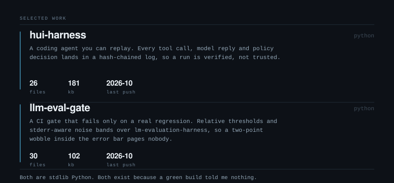

<picture>
  <source media="(prefers-color-scheme: dark)" srcset="docs/intro-dark.svg">
  <source media="(prefers-color-scheme: light)" srcset="docs/intro-light.svg">
  
</picture>

<picture>
  <source media="(prefers-color-scheme: dark)" srcset="docs/work-dark.svg">
  <source media="(prefers-color-scheme: light)" srcset="docs/work-light.svg">
  
</picture>

<picture>
  <source media="(prefers-color-scheme: dark)" srcset="docs/upstream-dark.svg">
  <source media="(prefers-color-scheme: light)" srcset="docs/upstream-light.svg">
  
</picture>

**I look for the failures that leave no trace** — Windows checkouts, non-UTF-8 locales, terminal capability differences.
Backend engineer working on LLM tooling and Go infrastructure.

[Upstream](#upstream-contributions) · [Case studies](#case-studies) · [Open PRs](#open-pull-requests) · [Projects](#projects) · [Toolchain](#toolchain)

## At a glance

| Metric | Value |
| --- | --- |
| Merged upstream PRs | 17 |
| Open upstream PRs | 43 |
| Repositories with a merged or open PR | 26 |
| Lines in merged PRs | +1,375 / -171 |
| File changes across merged PRs | 58 |
| Commits, last 12 months | 87 |
| Contributions, last 12 months | 247 |

## Upstream contributions

Every merged pull request, with the failure it fixed. The board above is the same ledger, drawn from the API.

| Project | PR | What changed | Merged |
| --- | --- | --- | --- |
| [`k8sgpt-ai/k8sgpt`](https://github.com/k8sgpt-ai/k8sgpt) | [#1851](https://github.com/k8sgpt-ai/k8sgpt/pull/1851) | Pin `filepath-securejoin` to v0.4.1 to unblock the License Compliance gate. | 2026-10-30 |
| [`k8sgpt-ai/k8sgpt`](https://github.com/k8sgpt-ai/k8sgpt) | [#1848](https://github.com/k8sgpt-ai/k8sgpt/pull/1848) | Assert the `EnsureDirExists` failure portably instead of relying on Unix paths. | 2026-10-30 |
| [`syncronix-labs/aegora`](https://github.com/syncronix-labs/aegora) | [#52](https://github.com/syncronix-labs/aegora/pull/52) | Evict the least recently used entry when the cache reaches capacity. | 2026-10-29 |
| [`syncronix-labs/aegora`](https://github.com/syncronix-labs/aegora) | [#50](https://github.com/syncronix-labs/aegora/pull/50) | Include the request ID in gateway-generated JSON errors. | 2026-10-29 |
| [`k8sgpt-ai/k8sgpt`](https://github.com/k8sgpt-ai/k8sgpt) | [#1841](https://github.com/k8sgpt-ai/k8sgpt/pull/1841) | Add direct in-process tests for the server-mode analyze handler. | 2026-10-28 |
| [`Mihirajmera/agent-access-review`](https://github.com/Mihirajmera/agent-access-review) | [#20](https://github.com/Mihirajmera/agent-access-review/pull/20) | Classify sqlite, brave-search and gdrive MCP servers in the catalog. | 2026-10-24 |
| [`Mihirajmera/agent-access-review`](https://github.com/Mihirajmera/agent-access-review) | [#19](https://github.com/Mihirajmera/agent-access-review/pull/19) | Add `--format json` to `scan` for machine-readable findings. | 2026-10-24 |
| [`pranshuparmar/witr`](https://github.com/pranshuparmar/witr) | [#245](https://github.com/pranshuparmar/witr/pull/245) | Make `TestDetectGitInfo` hermetic against Git repositories above the temp dir. | 2026-10-19 |
| [`syncronix-labs/aegora`](https://github.com/syncronix-labs/aegora) | [#19](https://github.com/syncronix-labs/aegora/pull/19) | Add a `--version` flag to the gateway CLI. | 2026-10-18 |
| [`bmf-san/ggc`](https://github.com/bmf-san/ggc) | [#542](https://github.com/bmf-san/ggc/pull/542) | Make the config and command tests pass on Windows. | 2026-10-16 |
| [`bmf-san/ggc`](https://github.com/bmf-san/ggc) | [#541](https://github.com/bmf-san/ggc/pull/541) | Replace Unix-only exec mocks in the git tests with a helper process. | 2026-10-16 |
| [`bmf-san/ggc`](https://github.com/bmf-san/ggc) | [#540](https://github.com/bmf-san/ggc/pull/540) | Make the config, interactive and history tests pass on Windows. | 2026-10-14 |
| [`k8sgpt-ai/k8sgpt-operator`](https://github.com/k8sgpt-ai/k8sgpt-operator) | [#855](https://github.com/k8sgpt-ai/k8sgpt-operator/pull/855) | Add tolerations to the K8sGPT CRD and chart so the controller can run on tainted nodes. | 2026-10-10 |
| [`pranshuparmar/witr`](https://github.com/pranshuparmar/witr) | [#242](https://github.com/pranshuparmar/witr/pull/242) | Root `main.go` was a tracked symlink; Git for Windows checks it out as a 16-byte text file, so `go build` fails on a real clone while CI stays green. Replaced it with a real entry point and added a lint guard. | 2026-10-04 |
| [`pranshuparmar/witr`](https://github.com/pranshuparmar/witr) | [#239](https://github.com/pranshuparmar/witr/pull/239) | `--help` silently lost its color legend on terminals without bright ANSI; fall back by terminal capability instead. | 2026-10-03 |
| [`nvm-sh/nvm`](https://github.com/nvm-sh/nvm) | [#3915](https://github.com/nvm-sh/nvm/pull/3915) | `nvm --help` rendered the set-colors legend as plain text; apply the same color variables inside the help branch. | 2026-09-03 |
| [`DependencyTrack/dependency-track`](https://github.com/DependencyTrack/dependency-track) | [#7096](https://github.com/DependencyTrack/dependency-track/pull/7096) | README CI badges pointed at a retired branch and 404'd; point them at `main`. | 2026-08-24 |

## Case studies

Three root causes, each written up with the failure, the mechanism and the evidence that it is fixed.

### 1. simonw/llm#1737 — written as UTF-8, read back with the system locale

| | |
| --- | --- |
| **Symptom** | On Windows with a `cp936` default encoding, saving a template and then running `llm -t <name>` fails with `UnicodeDecodeError: 'gbk' codec can't decode byte 0xaa in position 16`. The `-f fragment.md` and `--functions tool.py` paths fail the same way. |
| **Root cause** | The module disagreed with itself: `llm templates edit` wrote via `path.write_text(DEFAULT_TEMPLATE, "utf-8")` (`llm/cli.py:2646`) while `load_template()` read via `path.read_text()` (`llm/cli.py:4274`), which uses the locale encoding. The fragment and `--functions` paths (`llm/cli.py:293`, `llm/cli.py:4287`) were identical. |
| **Fix** | Added `_read_text_file()`: try UTF-8 first, fall back to the locale encoding only when the file is not valid UTF-8, so old GBK / CP1252 files keep working. This mirrors the existing `("utf-8", "latin-1")` fallback in `llm embed-multi --files`. |
| **Evidence** | Three regression tests (template, fragment, `--functions`) driven by a fixture that simulates a non-UTF-8 locale on any platform. All three failed before (`UnicodeDecodeError: 'ascii' codec...`) and pass after; the full suite ran `1185 passed, 1 skipped, 6 xfailed, 15 xpassed`. |

[View pull request](https://github.com/simonw/llm/pull/1737)

### 2. pranshuparmar/witr#242 — CI green, real Windows checkout cannot compile (merged)

| | |
| --- | --- |
| **Symptom** | After `git clone`, `go build ./...` fails with `main.go:1:1: expected 'package', found cmd`, `go test ./...` reports `[setup failed]`, and `make test` / `make lint` are broken on the machine. The repository's `Tests: Unit (windows-latest)` job was green. |
| **Root cause** | `git ls-files -s main.go` showed mode `120000`: the root entry point was a symlink to `cmd/witr/main.go`. Git for Windows defaults to `core.symlinks=false`, so the symlink lands as a 16-byte text file whose content is the string `cmd/witr/main.go` — a `.go` file that is not a valid Go package. CI hid it because `actions/checkout` does create real symlinks. |
| **Fix** | Replaced the root entry point with a real file and moved the entry logic into `internal/app.Main()` (`SetVersion` + `Execute`), shared by the root package and `cmd/witr`; added a lint guard that rejects tracked `120000` files. |
| **Evidence** | `go build ./...`, `go vet ./...`, `gofmt -l .` and `go test ./...` all pass; seven cross-compilations (linux amd64/loong64, darwin amd64/arm64, freebsd/amd64, windows amd64/arm64) exit 0; `go build .` and `go build ./cmd/witr` produce byte-identical `--help` (2237 chars) and `--version` output. |

[View pull request](https://github.com/pranshuparmar/witr/pull/242)

### 3. huggingface/accelerate#4360 — three Unix-only assumptions in `debug_launcher`

| | |
| --- | --- |
| **Symptom** | On Windows, `accelerate debug_launcher script.py` first fails with `ValueError: cannot find context for 'fork'`; bypassing that produces `PermissionError: [Errno 13]` because the child cannot open the rendezvous file. |
| **Root cause** | Three Unix-only assumptions: (1) `start_method="fork"` is hard-coded and Windows only has `spawn`; (2) the rendezvous file is created with `NamedTemporaryFile`, so the parent keeps the handle and the spawned child cannot open it; (3) `gloo_socket_ifname="lo"` is set unconditionally even though the Windows loopback interface is not `lo`. |
| **Fix** | `_debug_start_method()` chooses `fork` / `spawn` from platform capability; `NamedTemporaryFile` became `TemporaryDirectory` (only the path crosses the process boundary); `_has_loopback_alias()` probes for `lo` before setting the variable. |
| **Evidence** | Reproduced on a Windows host, then `debug_launcher` started a multi-process debug session. Relevant tests pass on Python 3.13 + torch 2.9 (`spawn` needs the `if __name__ == "__main__"` guard, documented in the docstring). The PR waits for maintainer workflow approval to run CI. |

[View pull request](https://github.com/huggingface/accelerate/pull/4360)

## Open pull requests

43 open across 21 upstream repositories. Highlights:

| PR | What it changes |
| --- | --- |
| [#68](https://github.com/syncronix-labs/aegora/pull/68) `syncronix-labs/aegora` | Optional per-route `timeout` bounding the whole outbound exchange, including the response body; negative values fail config validation. |
| [#4360](https://github.com/huggingface/accelerate/pull/4360) `huggingface/accelerate` | `debug_launcher` cannot start on Windows: `fork`, `NamedTemporaryFile` and a hard-coded `lo` interface are all Unix-only assumptions. |
| [#4384](https://github.com/EleutherAI/lm-evaluation-harness/pull/4384) `EleutherAI/lm-evaluation-harness` | Run the trailing partial chunk in `bootstrap_stderr` instead of dropping it. |
| [#26206](https://github.com/mlflow/mlflow/pull/26206) `mlflow/mlflow` | Artifact images were force-scaled and blurred; size them to the container width. |
| [#1845](https://github.com/k8sgpt-ai/k8sgpt/pull/1845) `k8sgpt-ai/k8sgpt` | Mute known findings through an exclusions config key; prints the finding hash users paste into the config (approved). |
| [#1737](https://github.com/simonw/llm/pull/1737) `simonw/llm` | Templates were written as UTF-8 but read with the locale encoding; use UTF-8 first with a locale fallback and add regression tests. |
| [#1880](https://github.com/tqdm/tqdm/pull/1880) `tqdm/tqdm` | Strip terminal control sequences from untrusted `desc` / message strings. |
| [#1720](https://github.com/anthropics/skills/pull/1720) `anthropics/skills` | `mcp-builder` wrote its evaluation report with the locale encoding; write UTF-8. |

[See every open pull request on GitHub](https://github.com/search?q=author%3ACJstate+is%3Apr+is%3Aopen&type=pullrequests)

## Projects

### [`hui-harness`](https://github.com/CJstate/hui-harness) — a coding agent you can replay

Every tool call, model reply and policy decision lands in a hash-chained JSONL log;
`hui replay` re-executes the session and fails on the first hash mismatch, so a run
is verified rather than trusted.

- 139 tests; `ruff check` / `ruff format --check` clean; CI matrix Linux / Windows / macOS × Python 3.10–3.13
- **Zero runtime dependencies** (`urllib` / `json` / `subprocess` / `difflib`); `pip install` pulls nothing
- Context compaction drops whole groups: an assistant `tool_call` and its result are never split apart
- Encoding and newlines handled for real Windows environments: UTF-8 → local code page (GBK / CP936) → Latin-1 fallback, preserving BOM and CRLF
- Permission policies: `read-only` / `workspace-write` / `danger-full-access`; about 20 destructive commands require explicit approval and `shell=True` is never used

### [`llm-eval-gate`](https://github.com/CJstate/llm-eval-gate) — turn evaluation noise into a CI verdict

Give it two lm-evaluation-harness result files (`before` / `after`) and it decides
whether the run actually regressed: a relative threshold plus a standard-error band,
instead of "the third decimal went down, turn the build red".

- 102 tests; **zero runtime dependencies** (`dependencies = []` in `pyproject.toml`)
- GitHub Actions green on Ubuntu (Python 3.11 / 3.12 / 3.13), Windows and macOS; the project runs itself as an action
- Model-agnostic: it reads harness result files, not model outputs

## How I work

| Habit | What it means |
| --- | --- |
| **Reproduce, then change code** | Every fix starts from a failure message I can paste, and ends with the output after the fix. The Symptom rows above are the original errors. |
| **Minimal diff + regression test** | Touch only the lines on the root-cause path; no drive-by formatting, renames or refactors. Where a test is possible, it is written to fail first. |
| **Environment-class defects, not trends** | The bugs I know best only appear in real environments: non-UTF-8 default encodings, Windows checkouts, first-contributor CI gates, terminal capability differences. They are expensive to reproduce, so few people report them — and easy to dismiss as low impact, so I have to show who actually hits them. |
| **Publish the misses** | Early on I sent documentation and formatting changes that maintainers closed as noise; a reproducible encoding bug was still called low impact because no real user had reported it and the repro was "synthetic". So I now ask before submitting: does a real user hit this? If not, find a real report or a concrete usage scenario first — and correct myself publicly when I get it wrong. |

## Toolchain

| Area | What I use |
| --- | --- |
| **Languages** | Python (3.9–3.13) · Go · TypeScript · Shell · PowerShell |
| **Training / inference** | PyTorch · Transformers · Accelerate · PEFT · FSDP · DeepSpeed · vLLM |
| **Data / evaluation** | Datasets · lm-evaluation-harness · MLflow · OpenLLMetry / OpenTelemetry |
| **Engineering** | pytest · ruff · mypy · GitHub Actions (Windows / macOS matrix) · Docker · Kubernetes |
| **Platforms** | Windows + Linux · terminal capability detection · encoding / locale compatibility · cross-compilation |

## Open to

AI / LLM infrastructure, training &amp; inference, and evaluation-tooling roles.

The three boards and the contribution tables are regenerated from the GitHub API by `tools/render_profile.py`; the two project test counts are measured locally.
